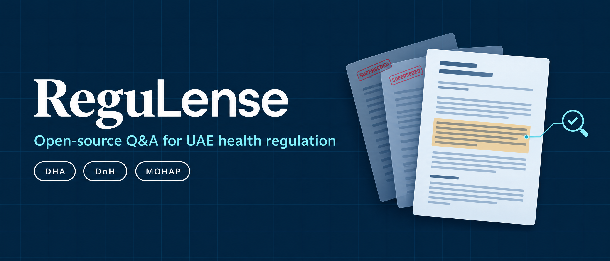
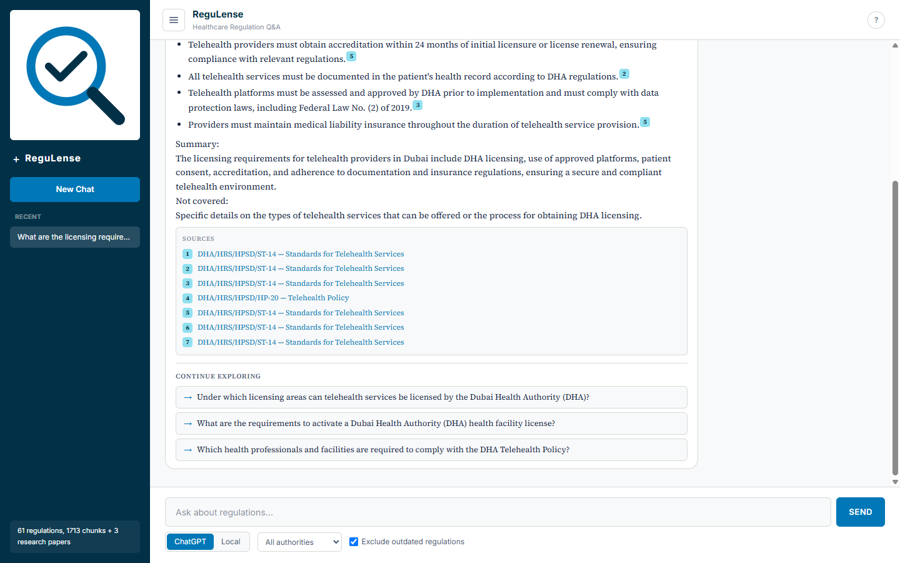
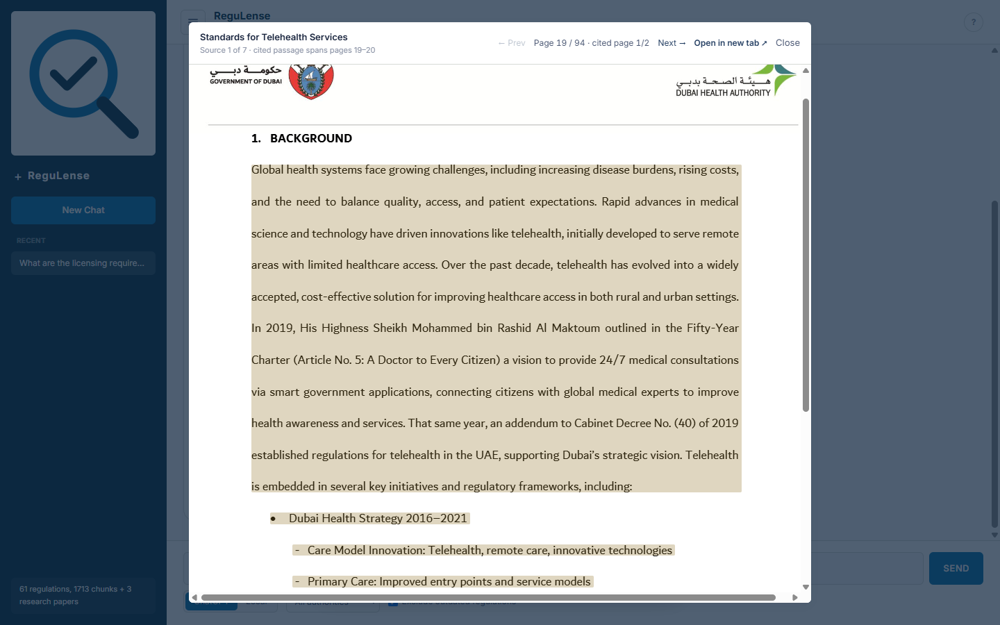
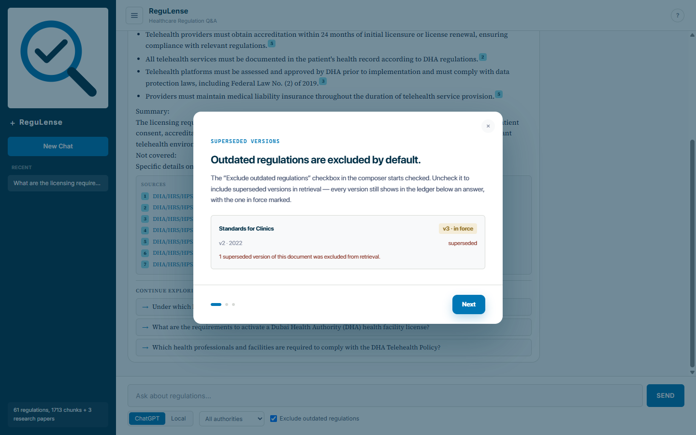
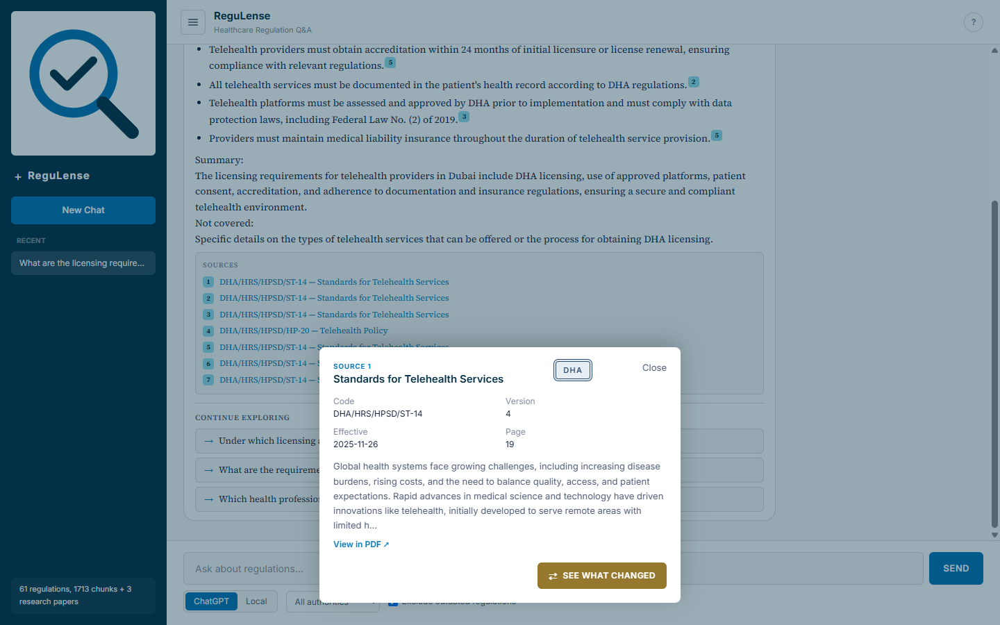
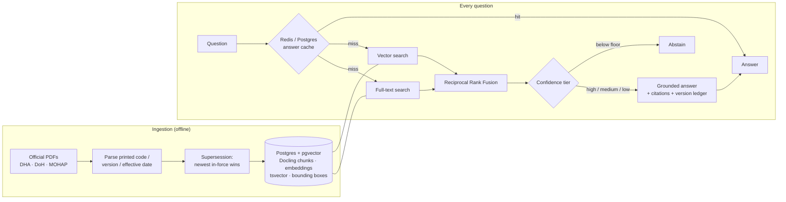

<p align="center">
  
</p>

<p align="center">
  <b>Ask UAE health regulation a question. Get the clause that is in force, in the right emirate, with the exact line highlighted in the source PDF, or an honest "I don't know".</b>
</p>

<p align="center">
  <a href="https://github.com/haitham72/regulense/actions/workflows/deploy.yml"></a>
  <a href="LICENSE"></a>
  
  
  
  <a href="https://neohealth-gpzo.onrender.com"></a>
</p>

---

ReguLense is an open-source retrieval-augmented Q&A system over the public health regulation of the UAE:
- **DHA** (Dubai)
- **DoH** (Abu Dhabi)
- **MOHAP** (federal)

It's for anyone who has to get these rules right: clinic owners and medical directors, compliance and licensing teams, healthtech companies entering the UAE, healthcare professionals preparing a licence application, and researchers.

Standard RAG fails at regulation in two expensive ways:
- **It cites rules that are no longer in force.** It has no concept of a document being superseded.
- **It mixes up jurisdictions.** It has no concept of which authority issued a rule.

ReguLense is built around both, plus a third rule: **no citation, no answer.**

<p align="center">
  
  
</p>

## Why it exists

DHA has published three versions of the same licensing manual (`DHA/HRS/HLD/MA-2`): 2022, May 2025 and July 2025. All three are still on its public site. A standard RAG system cites whichever version's text embeds closest, and gives no sign that two of them are dead.

| | Plain RAG | ReguLense |
|---|---|---|
| Superseded rules | Cited like any other chunk | Excluded by default; full version ledger shown |
| Jurisdiction | Ignored | DHA / DoH / MOHAP stamped on every clause; optional hard filter |
| Weak evidence | Answers anyway, confidently | Answers with an explicit certainty caveat |
| No evidence | Makes something up | Abstains: *"I don't have current guidance on that"* |
| Citation | "Somewhere in this PDF" | Document code, version, effective date, page, and the exact highlighted passage |
| Repeat questions | Full LLM call every time | Two-tier cache: Redis exact-match plus a Postgres paraphrase match |

## Features

- **Version-aware retrieval.** Supersession is resolved from each document's own printed footer (code, version, effective date), never from its filename or URL. One PDF in the corpus sits at a URL implying 2023, but it's actually Issue 4, effective November 2025.
- **Jurisdiction-aware retrieval.** Every chunk carries its issuing authority. Filter to one emirate, or see which authority each citation comes from.
- **Tiered confidence.** A calibrated floor abstains below it, and medium and low tiers answer with an in-text certainty line, so a shaky match never reads like a strong one.
- **Exact PDF highlights.** Docling structure-aware chunking stores each chunk's bounding boxes at ingest time. "View in PDF" opens the official document at the precise cited passage.
- **"See what changed".** Compares a cited clause with the version it replaced and explains the difference in plain language.
- **Bilingual hybrid search.** pgvector cosine search and Postgres full-text search (English and Arabic `tsvector`) are fused with Reciprocal Rank Fusion.
- **Redis-backed semantic answer cache.**
  - Redis is the fast exact-key layer.
  - Postgres keeps the durable copy and answers paraphrases (cosine ≥ 0.92).
  - Every boot warm-loads Redis from Postgres, so a cold, sleeping deployment serves cached answers on its very first request.
  - Each cached answer has a signed one-click eviction token.
- **"Continue exploring".** Follow-up questions are mined offline from each document, and every quote is verified verbatim against the indexed text before it's shown.
- **Safety rails.**
  - A deterministic input screen refuses prompt injection and redacts UAE personal identifiers.
  - An LLM relevance guardrail runs before generation.
  - Per-client rate limits and a daily cap on paid API calls.
  - Automatic failover to a backup LLM provider.
- **Local option.** Answer generation can run fully on your machine through any OpenAI-compatible local server (LM Studio).

<p align="center">
  
  
</p>

## How it works



The full design (retrieval maths, schema, caching, and the reasoning behind every non-obvious decision) is in [ARCHITECTURE.md](ARCHITECTURE.md).

## Quick start

```bash
git clone https://github.com/haitham72/regulense && cd regulense
cp backend/.env.example backend/.env      # add OPENAI_API_KEY
docker compose up --build                 # UI :8080 · API :8000 · Postgres :5433 · Redis :6379
```

Then build the corpus. Every step is idempotent; the full guide is [RUN.md §3](RUN.md#3-build-the-corpus).

```bash
cd backend && pip install -r requirements-ingestion.txt
python -m ingestion.download && python -m ingestion.ingest && python -m ingestion.apply_manual_fixes
python -m ingestion.load_db && python -m ingestion.rechunk
```

Or skip the setup and try the [live demo](https://neohealth-gpzo.onrender.com). It runs on a free tier, so the first request may take about 30 s to wake it.

## Use it for another regulator

Nothing is hardcoded to the UAE except the corpus. Point `backend/corpus_urls.txt` at any regulator whose documents print a code, version and effective date (a health authority, a central bank, a free zone), and you get version tracking automatically. Documents without parseable metadata go to `needs_manual.json` for review instead of being guessed.

## Corpus

| | |
|---|---|
| Official documents | 61 regulations (DHA, DoH, MOHAP) |
| Research | 3 peer-reviewed telehealth-policy papers, labelled as research and never styled as regulation |
| Chunks | 1,713 official structure-aware chunks |
| Follow-up questions | 263, verified verbatim against the source |
| Ingestion funnel | 68 downloaded → 40 parsed automatically → 28 refused (no printed metadata) → 24 recovered by OCR with every field checked against a verbatim quote |

`GET /corpus-stats` is the live source of truth.

## Tech stack

| Layer | Choice |
|---|---|
| Backend | FastAPI, Python 3.14 |
| Retrieval | Postgres 16 + pgvector, full-text `tsvector` (EN + AR), Reciprocal Rank Fusion |
| Chunking | Docling `HybridChunker` with a merge and re-split pass |
| Embeddings | OpenAI `text-embedding-3-small` (1536-d) |
| Generation | `gpt-4o-mini` (temperature 0) with automatic fallback, or local via LM Studio |
| Cache | Redis (L1 exact-key) + Postgres (L2 paraphrase) |
| Frontend | React 19, TypeScript, Vite, Tailwind v4 |
| Ops | Docker Compose; GitHub Actions running tests against a real pgvector |

## Disclaimer

ReguLense is a research and orientation tool, **not legal or regulatory advice**. Always confirm against the official publication from the issuing authority before acting on an answer. The regulatory documents are public publications of their respective authorities and are included only so that results can be reproduced.

## Contributing

Issues and PRs are welcome, especially corpus additions (new or updated DHA/DoH/MOHAP documents), Arabic retrieval improvements, and evaluation questions with known-correct answers. See [RUN.md](RUN.md) to get a dev environment running. Tests run against a real Postgres, not mocks.

## License

[MIT](LICENSE)
